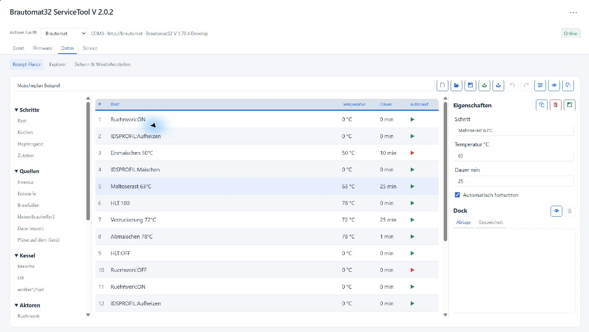
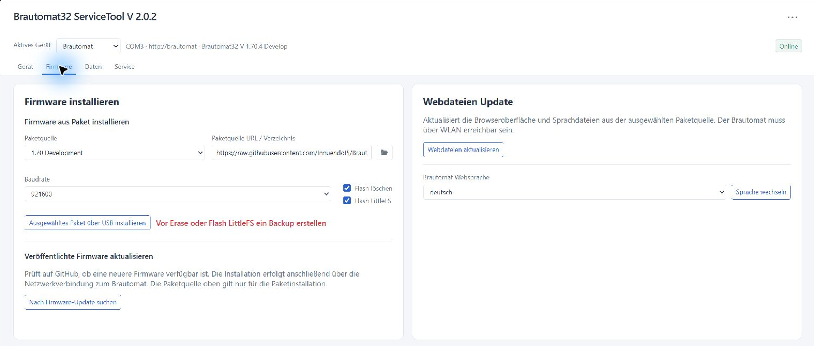
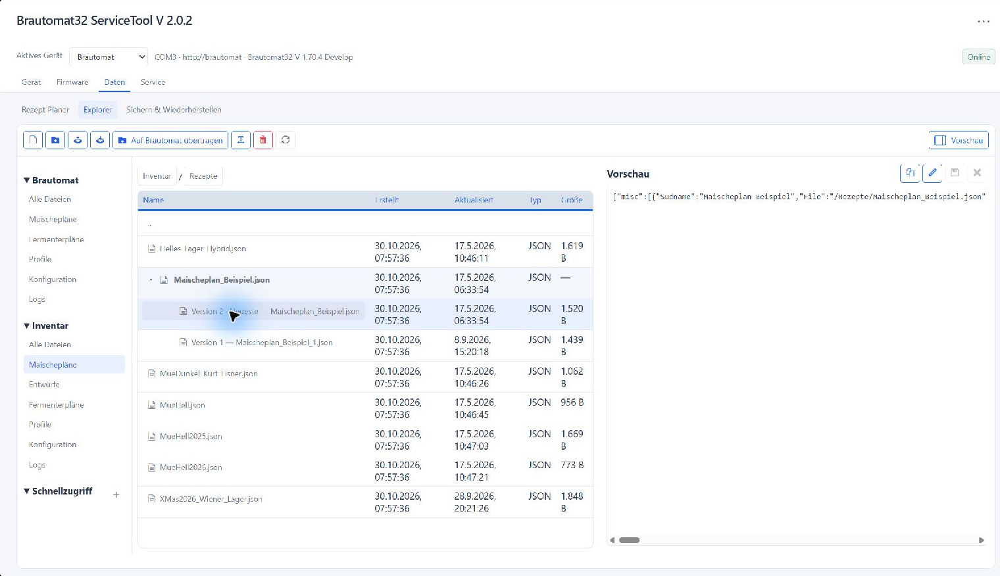
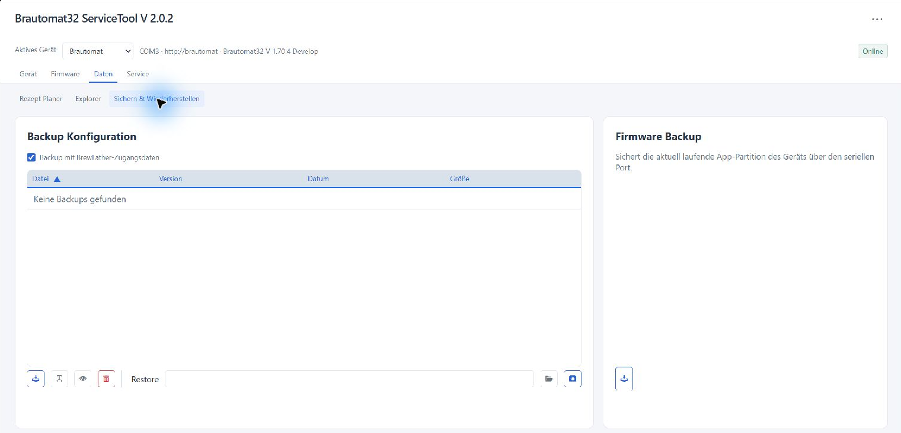
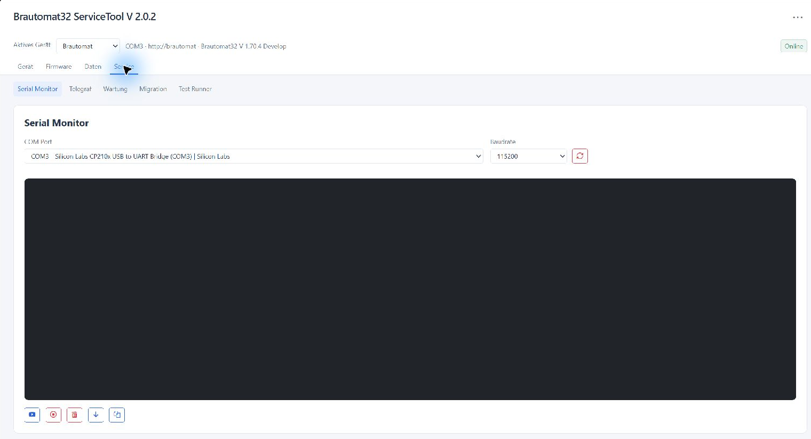
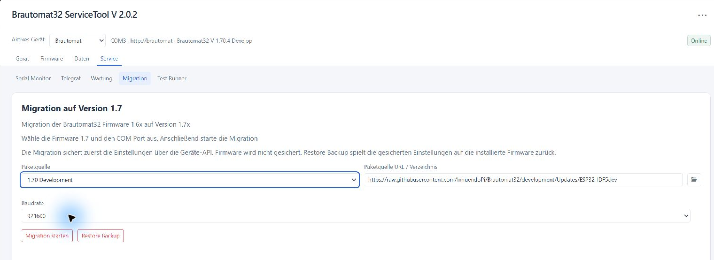

# Brautomat32 ServiceTool

Brautomat32 ServiceTool is the desktop companion for Brautomat32 devices.
It combines recipe planning, device management and maintenance in a local
browser interface for Windows, Linux and macOS.

This README describes the **2.0.2 source version**. Available release packages
may differ; see [Releases](https://github.com/InnuendoPi/ServiceTool/releases)
and [CHANGELOG.md](CHANGELOG.md).

Detailed instructions are available in the application's **Help** menu and in
[English](static/help/en.md) or [German](static/help/de.md).

It provides:

- recipe planning with reusable dock steps, drafts, versioning and comparison
- recipe import from Brautomat JSON, MaischeMalzundMehr, KBH2 and Brewfather
- configuration backup and restore
- firmware flashing and firmware backup
- web files update
- WiFi provisioning
- inventory management for recipes, fermenter plans, and profiles
- serial monitor
- Telegraf telemetry forwarding to CSV, InfluxDB v2, PostgreSQL,
  MariaDB/MySQL, and MQTT
- migration workflow for partition/layout changes
- optional local test-runner integration

## End-User Distribution

Brautomat32 ServiceTool is distributed as a complete desktop application.

The Windows package includes a bundled `esptool` copy. Linux and macOS packages
do not bundle it. ServiceTool uses **esptool 5.6.0** and verifies the version
of bundled, cached or downloaded copies. It downloads the matching platform
asset when needed and caches it locally. If GitHub is unreachable, a verified
local copy of that version can be used.

The ServiceTool checks its own repository manifest at
`https://raw.githubusercontent.com/InnuendoPi/ServiceTool/main/version.json`
at startup and when the update button is clicked. If a newer version is
available, the matching GitHub Release ZIP is downloaded, verified by SHA256,
and the download folder is opened. The user then extracts the ZIP and replaces
the old ServiceTool version manually.

## End-User Start

### Windows

1. Create any directory for the ServiceTool.
2. Extract the complete Windows release ZIP into that directory.
3. Start the executable.

### Linux

1. Create any directory for the ServiceTool.
2. Extract the Linux release ZIP into that directory.
3. Make it executable:

```bash
chmod +x Brautomat32ServiceTool.AppImage
```

1. Start it:

```bash
./Brautomat32ServiceTool.AppImage
```

### macOS

1. Extract `Brautomat32ServiceTool-macos.zip`.
2. Move `Brautomat32ServiceTool.app` into any directory.
3. Start the app bundle.
4. The packaged app opens the local UI in the browser on
   `http://127.0.0.1:<port>`. By default the tool uses port `8765`. If that
   port is already in use, it selects a free local port automatically.
5. If macOS shows `Brautomat32ServiceTool is damaged and can't be opened`,
   remove the quarantine attribute once in Terminal:

```bash
xattr -dr com.apple.quarantine /path/to/Brautomat32ServiceTool.app
```

1. If macOS still blocks the first start, open the app once via Finder using
   `Open` and confirm the security prompt.
2. The app bundle can stay in `Downloads`, but writable runtime data is stored
   separately in:

```text
~/Library/Application Support/Brautomat32ServiceTool
```

Typical runtime folders created there are `logs`, `cache`, `backups`, and
`inventar`.

## Firmware packages and repair

For the ServiceApp partition layout, normal USB flashing requires matching
`partitions.bin`, `firmware.bin` and `serviceapp.bin`. Both application images
are validated before serial handover and written even when Erase Flash is off.
An erase additionally requires the boot files and removes saved device data.
Use the guided migration for changing an older device's partition layout.
Migration supports targets from 1.67.0 with the verified ServiceApp layout.

For an extracted GitHub firmware ZIP, select the folder containing the `.bin`
files. If version metadata is absent, ServiceTool identifies a unique product
version inside the validated main firmware image. Web assets can be provided in
`webfiles/`, `data/`, or `Littlefs.bin`; no PlatformIO project is required.
Only the allowed web assets and language files are read from LittleFS, using
[littlefs-python](https://littlefs-python.readthedocs.io/en/latest/examples/index.html).
The package stays unchanged, and configuration files from its filesystem image
are not copied to the device. Corrupt or ambiguous packages are rejected before
flashing.

Firmware repair while the ServiceApp is running uploads only `firmware.bin`
over HTTP and leaves the ServiceApp and filesystem intact. Device file rename
uses the ServiceApp's generic file API in this mode.

Configuration restores validate the backup JSON before upload and wait for the
device to respond again. If transfer confirmation is missing, inspect the
device state before retrying; the tool does not automatically repeat a restore.

## Runtime Layout

The application serves static files from the bundled `static` directory.

At runtime it separates application files from writable data:

- bundled application files stay inside the packaged app location
- bundled `esptool` is resolved relative to the packaged app location
- writable runtime data is stored in a dedicated data directory

Runtime data includes:

- `backups`
- `logs`
- `cache`
- `inventar`
- `designer` (drafts, Dock and saved planning data)
- `config.json`

Runtime data location:

- Windows packaged app: next to the executable
- Linux AppImage: `~/.local/share/Brautomat32ServiceTool`
- macOS app bundle: `~/Library/Application Support/Brautomat32ServiceTool`
- source run: next to `app.py`

These runtime folders are intentionally excluded from git.

## Using the ServiceTool

The screenshots show ServiceTool 2.0.2 with German interface labels.
The migration image shows package selection, not a completed migration.

The interface has four main areas. The active device, serial port, URL,
firmware version and connection/process status appear in the header.

| Area | Functions |
| --- | --- |
| Device | Connection check, COM port, device URL and WiFi setup |
| Firmware | USB, published firmware updates, web files and language |
| Data | Recipe Planner, Explorer, Backup & restore |
| Service | Monitor, Telegraf, Maintenance, Migration, optional Test runner |

The three-dot menu opens **Settings**, **Check for updates** and **Help**.
Settings include language, appearance, device profiles and recipe sources.
Up to 20 device profiles can store separate names, ports and URLs. Select the
intended device before any upload, restore or firmware operation.

### Connect a device and configure WiFi

1. Connect the Brautomat over USB and select its COM port under **Device**.
2. Enter its network URL and run the connection check.
3. If WiFi is not configured, scan for networks, select the SSID, enter the
   password and save. The device restarts with the new credentials.
4. Check the connection again after restart.

**Serial connected** confirms USB detection, not network availability.
**Online** confirms API access; the process status separately indicates whether
brewing or fermentation is active. An unknown process status is not confirmation
that the device is idle. Network functions also depend on firmware support.
Local recipe planning remains available without a connected device.

### Recipe Planner



Open **Data → Recipe Planner**. Sources and building blocks are on the left,
the executable mash plan is in the centre, and step properties and the **Dock**
are on the right.

1. Create a new plan or load a recipe from inventory, a draft, a file or a
   connected device.
2. Add rests, boil steps, hop additions and ingredients. Drag kettles, actors
   and profiles into the plan to include device commands.
3. Select a step to edit its name, temperature, duration and automatic
   continuation. Use drag-and-drop to reorder steps; Shift/Ctrl supports
   multiple selection. Undo and Redo apply to edits in the working plan.
4. Use **Review plan** to inspect warnings and resource assignments. Use
   **Compare mash plan** to compare a second draft or file alongside the plan.
5. Save a draft while working. Choose **Move to inventory** when ready, or
   transfer the executable plan to the selected device after reviewing it.

Supported recipe sources:

| Source | How to use it |
| --- | --- |
| Brautomat JSON | Import a file or open a device/inventory plan |
| MaischeMalzundMehr | Import a recipe JSON export |
| kleinerBrauhelfer2 | Import JSON or read recipes from its SQLite database |
| Brewfather | Import JSON or load recipes/batches through the account API |
| ServiceTool drafts | Reopen local working copies with their planning data |

Set the Brewfather User ID/API key and KBH2 database path under
**Settings → Recipe sources**. KBH2 database access is read-only.
Import defaults control temperatures for imported steps. Review imported
quantities, timing and device commands before transferring a plan.

The **Dock** holds reusable steps across plans and restarts. Dragging steps
from the plan into the Dock moves them; dragging them back into a plan copies
them. Dock steps are not executed or uploaded to the device.

Drafts support updating the current version, saving a new version and creating
an independent variant. Moving a draft to inventory offers a destination folder
and version/replacement options. After a successful move, that draft and its
intermediate versions are removed; other variants remain. Opening an inventory
plan creates a working copy. Only the executable plan is exported to the device;
Dock contents and supporting planning data stay local.

### Firmware



Select **1.66 Release**, **1.66 Development** or **1.70 Development**, or choose
an offered **Special Version**. **Open directory** selects an extracted local
package. Wait for package validation before installing.

| Firmware generation | Release package | Development package |
| --- | --- | --- |
| 1.66.x | `main/build/ESP32-IDF5` | `development/build/ESP32-IDF5dev` |
| 1.70 | Not defined | `development/Updates/ESP32-IDF5dev` |

A missing package is not replaced with one from a different generation.
Special versions use the selected ref consistently for version information and
package files. The actual images and layout must also be compatible.

For USB installation, select the target package and flash baud rate, then check
**Erase flash** and **Flash LittleFS** independently. Erasing removes settings
and files; writing LittleFS replaces the filesystem with the package contents.
If erase is enabled but LittleFS flashing is disabled, the filesystem is erased
without being populated again. Back up required data before using either option.

Direct USB installation supports switching between 1.66 and 1.70, including
returning to 1.66. It does not create an automatic backup or automatically
recover the previous state. For a guided move from 1.66 to 1.70, use
[Service → Migration](#migration-from-166-to-170).

**Check for firmware update** looks for published firmware separately from the
selected USB package. Network updates require an online device with a confirmed
idle process state and do not perform the old-to-ServiceApp layout migration.

Web-file and device-language updates use the selected repository package and
must match the installed firmware generation. These separate actions are not
available for **Open directory**. ServiceTool's own interface language is set
in **Settings**.

### Explorer



Open **Data → Explorer** to manage device files and the local inventory.
Choose a location and use the shortcuts for recipes, fermenter plans, profiles,
configuration and logs. Search, sorting and text preview help locate files.

- Copy files between the connected device and inventory.
- Create folders, rename files and delete selected entries after confirmation.
- Edit text files from the preview; JSON is validated before saving.
- Inspect inventory versions and open recipes in the Recipe Planner.

Device operations require network access. Local inventory remains available
offline. Check the destination before replacing files; a local folder name does
not change the selected target device.

### Backup & restore



Open **Data → Backup & restore** to create and manage configuration backups.
Backups can be named, annotated, inspected and restored from the local list or
a selected JSON file. Restore validates the JSON and waits for the device to
respond again.

**Firmware Backup** reads the running application image over USB. It is not a
complete backup of settings or the filesystem. Migration backups have their own
recovery workflow described below.

### Serial monitor



Open **Service → Serial monitor**, select the port and baud rate (normally
115200), and start logging. Output can be cleared or copied; autoscroll can be
switched off for inspection.

For flashing and firmware backup, ServiceTool temporarily releases the serial
port and schedules the monitor's restart afterwards if it was active. Check the
resulting status. Reboot prefers HTTP when available, with serial fallback.

### Telegraf

**Service → Telegraf** configures a separate Telegraf process. Telegraf reads the
Brautomat endpoint `<device-url>/telemetry` and forwards the current metrics to
each enabled destination. The ServiceTool only generates the temporary Telegraf
configuration, starts/stops the process, and shows its output.

Telegraf is not bundled with the ServiceTool. On the first Telegraf start, the
ServiceTool downloads the matching Telegraf version for the current platform
into its local `cache/tools` runtime directory. Internet access is required for
this one-time download. The official download page is:

<https://www.influxdata.com/downloads/>

An existing `telegraf` (on Windows `telegraf.exe`) on `PATH`, a binary in a
`telegraf/` directory next to the ServiceTool executable, or a full path set in
the Telegraf tab takes precedence over the downloaded cache copy.
The Telegraf configuration files, including any credentials, are generated in
a protected temporary runtime directory and removed after the process stops.

The ServiceTool does not save destination passwords by default. Enable the
explicit checkbox in the Telegraf tab only when storing them in the local
`config.json` is intended.

### Migration from 1.66 to 1.70



Use **Service → Migration** for the guided transition from the old partition
layout to the ServiceApp layout. Supported sources are **1.62.0 through 1.66.x**;
no intermediate firmware update is required. The target must have a verified
compatible ServiceApp layout (1.67.0 or newer). The current development target
is **1.70 Development**. Supported devices use ESP32 with 4 MiB flash and the
old symmetric layout.

1. Finish all mash and fermentation processes. Connect the device over USB
   and make sure it is also reachable at its network URL.
2. Check the active device, COM port and source firmware version.
3. Open **Service → Migration** and select **1.70 Development**, a compatible
   special version or a complete extracted local package. Firmware and migration
   share the package selection.
4. Start migration and keep power, USB and network connectivity available.
5. Read the final result, verify the target version and check the device's
   browser interface and saved configuration.

ServiceTool validates the package and web files, saves the device's complete
API backup, and then installs boot files, main firmware and ServiceApp.
NVS settings and LittleFS user files are retained; matching web files are
updated. Migration does not perform a full flash erase or create a full flash
image backup. Its backup and report are stored under `backups/migrations/`.

If installation is interrupted, follow the displayed recovery session and use
**Resume migration** while its installation files remain cached. After a failed
write check, ServiceTool does not automatically reboot. Other serial actions
may remain blocked until recovery.

**Restore Backup** restores saved settings over the device API to the installed
firmware. It requires network access and does not return the device to 1.66.
Older full-flash backups retain their separate USB restore workflow.
See [MIGRATION.md](MIGRATION.md) for package contents and recovery details.

### Maintenance mode

Use **Service → Maintenance** to start the ServiceApp over
USB and return to the main firmware. Maintenance requires a compatible ServiceApp;
firmware through 1.66.x needs migration first.

While maintenance mode is active:

- Repair the main firmware from the Firmware tab. Only the main application is
  uploaded; flash erase and LittleFS flashing are disabled.
- Use **Data → Explorer** to read, replace and delete configuration files,
  mash/fermenter plans and profiles over the network.
- Reset the saved brewing state when it prevents normal operation.
- Save WiFi credentials under **Device** over USB. Saving does not by itself
  confirm a successful WiFi connection. WiFi reading, scanning and reset are
  not supported by the ServiceApp.

The operating mode and any restriction on returning to the main firmware are
updated automatically. Network repairs use the ServiceApp address; an explicitly
entered device IP is retained. The main firmware starts only after the ServiceApp
allows the switch.

If an interrupted update prevents startup, ServiceTool displays a repair message
and a **Repair main firmware** button. Select the desired package under
**Firmware**, then return to **Service → Maintenance** and confirm the repair.
The ServiceApp must be reachable over WiFi; WiFi settings can be saved over USB
first. ServiceTool uploads and verifies the main firmware,
checks that the incomplete-update flag was cleared, and starts the main firmware
only if no other boot restriction remains. Configuration and filesystem are kept.
A regular USB firmware upload alone does not clear this persistent repair flag.

## End-User Requirements

- network access for GitHub downloads when firmware packages or tools are
  fetched dynamically

## Development

This repository contains only the Brautomat32 ServiceTool. The Brautomat32
firmware is maintained separately and is not required for normal ServiceTool
development.

Requirements:

- Python 3.12
- dependencies from `requirements.txt`
- a supported browser

Create a virtual environment, install the dependencies, and start the source
version:

```powershell
python -m venv .venv
.\.venv\Scripts\Activate.ps1
python -m pip install -r requirements.txt
python app.py
```

The local UI is then available on the address printed by the application,
normally `http://127.0.0.1:8765`.

Runtime files such as `config.json`, logs, backups, downloaded tools, and local
inventory are intentionally excluded from git. Never commit real WiFi,
database, InfluxDB, or MQTT credentials.

The optional Test Runner integration is not part of this repository. Its tab
is only shown when a complete local Brautomat32 development checkout is
configured through `BRAUTOMAT32_SOURCE_ROOT`. See
[CONTRIBUTING.md][contributing] for the required files and setup.

[contributing]: https://github.com/InnuendoPi/ServiceTool/blob/main/CONTRIBUTING.md

### Testing without hardware

The Telegraf integration can be tested locally without a Brautomat32 device.

Start a mock telemetry endpoint:

```powershell
python tools/mock_server.py
```

Then enter `http://localhost:8080` as the Brautomat URL in the ServiceTool.
Use `python tools/mock_server.py --addr :9090` when port `8080` is already in
use.

Optional local backend services for Telegraf targets are available through
Docker Compose:

```powershell
docker compose up -d
```

This starts PostgreSQL, MariaDB, InfluxDB v2, Mosquitto, and Grafana with
local test credentials only. Stop them with `docker compose down`; add
`--volumes` to remove their test data as well.

The services are reachable on `localhost`:

| Service | Address / Port | Local test access |
| --- | --- | --- |
| Grafana | <http://localhost:3000> | `brautomat` / `brautomat` |
| InfluxDB | <http://localhost:8086> | org/bucket `brautomat`, token `brautomat-token` |
| Mosquitto | `localhost:1883` | anonymous MQTT |
| PostgreSQL | `localhost:5432` | database/user/password `brautomat` |
| MariaDB | `localhost:3306` | database/user/password `brautomat` |

Portable Grafana dashboard examples are stored in `examples/grafana/`. They
can be imported into a separate Grafana instance and then pointed at an
existing InfluxDB, PostgreSQL, or MySQL datasource.

## Builds

Windows can be built locally with:

```powershell
.\build_servicetool_windows_release.ps1
```

The GitHub Actions workflow `ServiceTool Build` is manual-only and builds
Windows, Linux, and macOS packages. It uploads the generated ZIP files as
temporary workflow artifacts.

Release packages are deliberately ignored by git. Publish reviewed packages
as GitHub Release assets in this repository instead of committing them to
repository history. Start the same manual workflow with `Publish release`
enabled to publish the three verified packages. The workflow updates and
commits `version.json` with the matching release URLs and SHA256 values.

## Repository Layout

- `app.py`: local HTTP backend, device communication, and tool orchestration
- `designer.py`: recipe imports, drafts and planning data
- `explorer.py`: device files and local inventory
- `migration.py`, `maintenance.py`: layout migration and ServiceApp maintenance
- `telegraf.py`: Telegraf configuration, process management and binary download
- `static/`: browser UI
- `tools/mock_server.py`: local `/telemetry` mock device for Telegraf testing
- `docker-compose.yml`, `docker/`: local Telegraf backend test services
- `examples/grafana/`: portable Grafana dashboard examples
- `static/help/`: German and English user guides
- `Brautomat32ServiceTool.spec`: PyInstaller configuration
- `build_servicetool_windows_release.ps1`: local Windows release build
- `.github/workflows/servicetool-build.yml`: manual cross-platform builds
- `version.json`: update manifest used by released applications
- `tasks/`: shared ServiceTool development tasks; no firmware test-runner data
- `CONTRIBUTING.md`: contribution, release, and private test-runner setup

## License

The ServiceTool source is licensed under the [MIT License](LICENSE).
